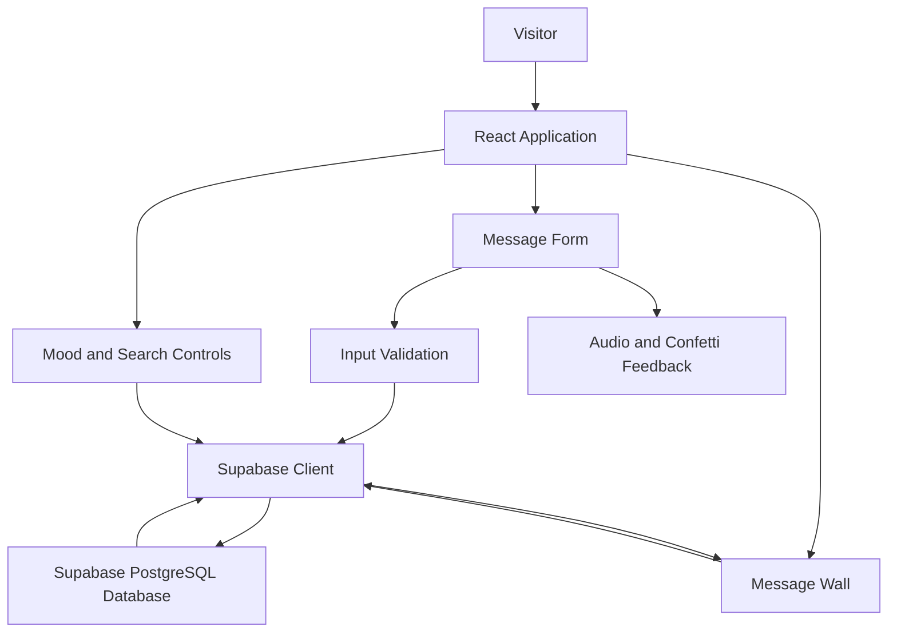

# ECHO Guest

### Every thought leaves an echo.

**A collective digital guestbook for sharing thoughts, emotions, stories, and reflections.**


---

## Overview

**ECHO Guest** is a web-based digital guestbook that allows visitors to share their thoughts, emotions, memories, and personal reflections in a common digital space.

Unlike temporary social media posts, ECHO Guest stores submitted messages in a persistent database, allowing visitors to explore and revisit reflections shared by others.

Users can submit messages using their names or pseudonyms, select a mood, and discover messages through interactive search and filtering features.

> **Make your voice bold.**

## Problem Statement

Personal thoughts, memories, appreciation, and reflections are often shared through temporary platforms where they can quickly become difficult to find or are eventually lost.

ECHO Guest addresses this problem by providing a shared digital platform where visitors can:

- Express themselves without creating an account.
- Share thoughts with a selected emotional mood.
- Explore messages submitted by other visitors.
- Search and filter messages.
- Preserve reflections in a persistent database.

## Key Features

### 1. Digital Guestbook
- Submit messages using a name or pseudonym.
- Write reflections up to 500 characters.
- No application-level sign-up flow is required.
- Input validation before submission.

### 2. Mood-Based Messages

Users can choose from five different moods:

| Mood | Description |
|---|---|
| Happy | Radiant warmth and joyful spirit |
| Inspired | Imagination and inspiration |
| Grateful | Appreciation and gratitude |
| Curious | Questions and exploration |
| Peaceful | Calm and quiet reflection |

Each mood has its own visual identity and associated sound frequency.

### 3. Interactive Message Wall
- Display previously submitted messages.
- Search messages by author name or content.
- Filter messages by mood.
- Load additional messages using pagination.
- Refresh the message wall.
- Display submission dates and mood information.

### 4. Audio Experience
- Mood-based synthesized sounds.
- Interactive audio feedback.
- Harmonic sounds after successful submissions.
- Mute and unmute functionality.
- Browser storage for mute preferences.

### 5. Visual Experience
- Modern dark-themed interface.
- Responsive design.
- Animated message cards.
- Interactive visual elements.
- Mood-based glow effects.
- Confetti animation after successful submissions.
- Smooth scrolling and transitions.

### 6. Database Configuration
- Supabase project URL configuration.
- Supabase anonymous/publishable key configuration.
- In-app database setup interface.
- Database connection testing.
- SQL schema setup support.
- Sample message loading.

## Technology Stack

| Technology | Purpose |
|---|---|
| React 19 | Frontend user interface |
| TypeScript | Type safety |
| Vite 8 | Development and build tooling |
| Tailwind CSS 4 | Styling and responsive design |
| Supabase | Backend and PostgreSQL database |
| Supabase JS | Database integration |
| Motion | Animations and transitions |
| Lucide React | Interface icons |
| Canvas Confetti | Success animations |
| Web Audio API | Audio generation |
| Netlify | Deployment |

## System Architecture



### Application Workflow

1. Visitor opens the ECHO Guest application.
2. Application checks the Supabase configuration.
3. Existing messages are retrieved from the database.
4. Visitor explores messages using search and mood filters.
5. Visitor enters a name, message, and mood.
6. Application validates the submitted information.
7. Validated messages are inserted into Supabase.
8. Successful submission triggers visual and audio feedback.
9. The message wall updates with the newly submitted message.

## Project Structure

```text
echo-guest/
│
├── public/
│   └── assets/
│       └── images/
│
├── src/
│   ├── assets/
│   │   └── images/
│   │
│   ├── components/
│   │   ├── Navbar.tsx
│   │   ├── Hero.tsx
│   │   ├── ConceptSection.tsx
│   │   ├── MessageForm.tsx
│   │   ├── MessageWall.tsx
│   │   ├── MessageCard.tsx
│   │   ├── DatabaseModal.tsx
│   │   ├── Footer.tsx
│   │   └── InteractiveOrb.tsx
│   │
│   ├── lib/
│   │   ├── audio.ts
│   │   ├── constants.ts
│   │   └── supabase.ts
│   │
│   ├── types/
│   │   └── echo.ts
│   │
│   ├── App.tsx
│   ├── main.tsx
│   └── index.css
│
├── .env.example
├── .gitignore
├── index.html
├── metadata.json
├── netlify.toml
├── package.json
├── tsconfig.json
├── vite.config.ts
└── README.md
```

## Getting Started

### Prerequisites

Make sure you have installed:

- Node.js
- npm or Bun
- Supabase account

### 1. Clone the Repository

```bash
git clone https://github.com/Kishore2005-Tech/echo-guest.git
```

### 2. Navigate to the Project

```bash
cd echo-guest
```

### 3. Install Dependencies

Using npm:

```bash
npm install
```

Or using Bun:

```bash
bun install
```

### 4. Configure Environment Variables

Create a `.env` file in the root directory.

```env
VITE_SUPABASE_URL="https://your-project.supabase.co"
VITE_SUPABASE_ANON_KEY="your-supabase-anon-or-publishable-key"
APP_URL="http://localhost:3000"
```

Replace the example values with your actual Supabase project credentials.

**Security:** Never expose your Supabase service-role key, database password, or privileged credentials in frontend environment variables.

### 5. Configure Supabase Database

1. Open your Supabase project.
2. Navigate to SQL Editor.
3. Create a new SQL query.
4. Execute the following SQL schema.

```sql
CREATE TABLE IF NOT EXISTS public.echo_messages (
    id UUID PRIMARY KEY DEFAULT gen_random_uuid(),
    name TEXT NOT NULL
        CHECK (char_length(name) >= 2 AND char_length(name) <= 50),
    message TEXT NOT NULL
        CHECK (char_length(message) >= 3 AND char_length(message) <= 500),
    mood TEXT NOT NULL
        CHECK (mood IN (
            'Happy',
            'Inspired',
            'Grateful',
            'Curious',
            'Peaceful'
        )),
    created_at TIMESTAMPTZ NOT NULL DEFAULT now()
);

CREATE INDEX IF NOT EXISTS idx_echo_messages_created_at
ON public.echo_messages (created_at DESC);

ALTER TABLE public.echo_messages ENABLE ROW LEVEL SECURITY;

CREATE POLICY "Allow public read access"
ON public.echo_messages
FOR SELECT
USING (true);

CREATE POLICY "Allow public insert access"
ON public.echo_messages
FOR INSERT
WITH CHECK (
    char_length(name) >= 2
    AND char_length(name) <= 50
    AND char_length(message) >= 3
    AND char_length(message) <= 500
    AND mood IN (
        'Happy',
        'Inspired',
        'Grateful',
        'Curious',
        'Peaceful'
    )
);
```

This creates the message table, enables Row Level Security, and allows public reading and validated message insertion.

**Note:** For an existing database, check existing policies before running this script to avoid duplicate policy errors.

### 6. Start the Development Server

Using npm:

```bash
npm run dev
```

Using Bun:

```bash
bun run dev
```

Open your browser:

```text
http://localhost:3000
```

## Available Scripts

| Command | Description |
|---|---|
| `npm run dev` | Start development server |
| `npm run build` | Build production application |
| `npm run preview` | Preview production build |
| `npm run lint` | Run TypeScript checks |
| `npm run clean` | Remove build output |

## Database Configuration

ECHO Guest also provides an in-app database configuration interface.

Users can:

1. Open the database setup modal.
2. Enter the Supabase project URL.
3. Enter the anonymous/publishable key.
4. Save the configuration.
5. Test the database connection.
6. Configure the required database schema.

Custom credentials are stored in browser local storage and take precedence over environment credentials while present.

## Deployment

ECHO Guest includes Netlify deployment configuration.

### Deploy Using Netlify

1. Push your project to GitHub.
2. Open [Netlify](https://www.netlify.com/).
3. Select Import an existing project.
4. Connect your GitHub account.
5. Select the ECHO Guest repository.
6. Configure the build settings.

| Configuration | Value |
|---|---|
| Build command | `npm run build` |
| Publish directory | `dist` |

7. Add the required environment variables in Netlify.

```env
VITE_SUPABASE_URL=https://your-project.supabase.co
VITE_SUPABASE_ANON_KEY=your-supabase-anon-or-publishable-key
APP_URL=https://your-domain.netlify.app
```

8. Deploy the application.

## Database Schema

The application uses the following database structure:

| Field | Data Type | Description |
|---|---|---|
| id | UUID | Unique message identifier |
| name | TEXT | Author name or pseudonym |
| message | TEXT | Submitted reflection |
| mood | TEXT | Selected mood |
| created_at | TIMESTAMPTZ | Submission timestamp |

### Validation Rules

- Name: 2–50 characters.
- Message: 3–500 characters.
- Mood: One of the five supported moods.
- Messages are ordered by creation date.
- The message wall loads nine records per page.

## Security and Privacy

- Supabase Row Level Security is enabled.
- Only anonymous/publishable credentials should be exposed in the frontend.
- Service-role keys must remain private.
- Public message insertion should be protected against spam and abuse.
- Rate limiting and moderation are recommended for production.
- Custom credentials saved through the setup interface are stored in browser local storage.

## Future Enhancements

Potential improvements for future versions:

- Message moderation and reporting.
- Spam detection and rate limiting.
- Optional user authentication.
- Real-time message updates.
- Reactions and appreciation features.
- Additional mood categories.
- Accessibility improvements.
- Admin dashboard and analytics.
- Automated testing and CI/CD integration.

## Contributing

Contributions, suggestions, and bug reports are welcome.

1. Fork the repository.
2. Create a new branch.

```bash
git checkout -b feature/your-feature-name
```

3. Make your changes.
4. Test your implementation.

```bash
npm run lint
npm run build
```

5. Commit your changes.

```bash
git commit -m "Add: describe your changes"
```

6. Push your branch and create a Pull Request.

## License

No license file was identified during this repository review. Add a LICENSE file to specify the terms under which this project may be used, modified, and distributed.

## Author

**Kishore2005-Tech**

- GitHub: [@Kishore2005-Tech](https://github.com/Kishore2005-Tech)
- Repository: [ECHO Guest](https://github.com/Kishore2005-Tech/echo-guest)

---

<div align="center">

### ECHO Guest

**Make your voice bold.**

*Every thought leaves an echo.*

</div>
